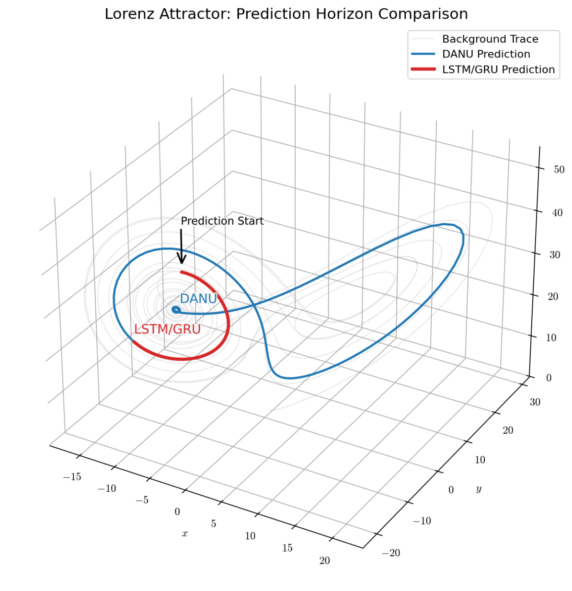

# DANU: Dendritic Attractor Neuron Unit

<p align="center">
  
</p>

Implementation accompanying the paper:

> **DANU: The Dendritic Attractor Neuron Unit for Infant Degenerated EEG Prediction**  
> Alessandro Crimi, Cris Micheli, Max Talanov, Tiziana Currieri, Francesco Prinzi, Salvatore Vitabile

---
# Experiments

The repository reproduces the experiments presented in the paper.

## 1. Lorenz-96 Forecasting

Chaotic multivariate time-series prediction on the Lorenz-96 system.

**Task**

- Input sequence: 100 time steps
- Prediction horizon: 10 future steps
- Loss: Mean Squared Error (MSE)
 

---

## 2. Cork Neonatal EEG Dataset

Next-step prediction of neonatal EEG recordings acquired from infants with hypoxic-ischaemic encephalopathy (HIE).

Dataset:

- 169 recordings
- 53 neonates
- 4 EEG severity grades

Task:

- Window length: 512 samples
- Predict next EEG sample
 
 
---

## 3. Synthetic Hippocampal Recordings

Prediction of simulated hippocampal activity generated from a biologically-inspired CA3–CA1 spiking neural network.

The simulator progressively increases recurrent excitation in CA3 to generate four dynamical regimes.
 

---

# Implemented Models

The repository contains implementations of

- DANU (proposed)
- Tractable Dendritic RNN
- GRU
- LSTM

All models share identical training protocols for fair comparison.

---

# Installation

Clone the repository

```bash
git clone https://github.com/alecrimi/DANU.git
cd DANU
```

Install dependencies

```bash
pip install -r requirements.txt
```

Main dependencies

- Python ≥ 3.10
- PyTorch
- NumPy
- SciPy
- Matplotlib
- pandas
- scikit-learn
- NEST Simulator (hippocampal experiments only)

---
 
Each experiment automatically

- trains all compared models
- performs early stopping
- evaluates the validation MSE
- computes statistical comparisons
- generates publication-quality figures

---

# Citation

If you use this code, please cite

```bibtex
@article{crimi2026danu,
  title={DANU: The Dendritic Attractor Neuron Unit for Infant Degenerated EEG Prediction},
  author={Crimi, Alessandro and Micheli, Cris and Talanov, Max},
  journal={},
  year={2026}
}
```

---

# Acknowledgements

The research presented in this article received partial funding from the Polish Ministry of Science and Higher Education assigned to the AGH University of Science and Technology in Krakow. 

---

# License

MIT License.
